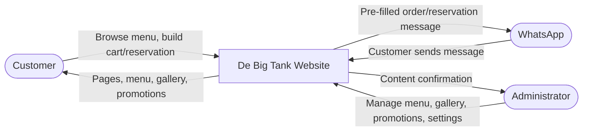
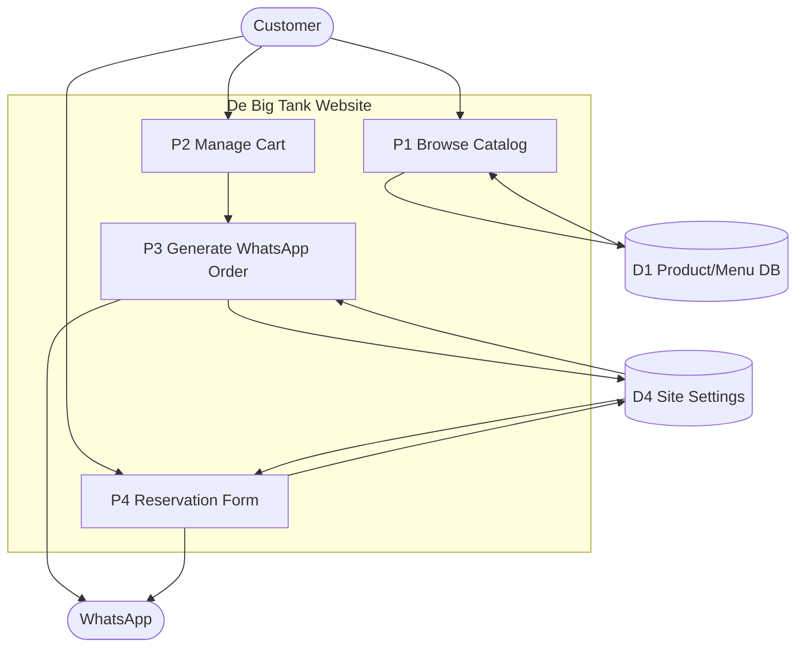
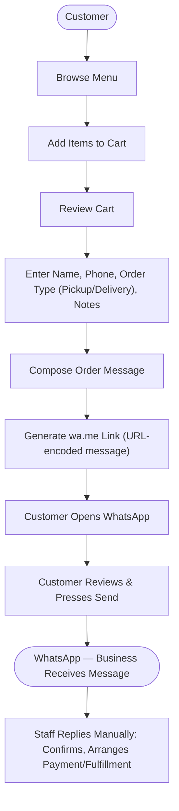
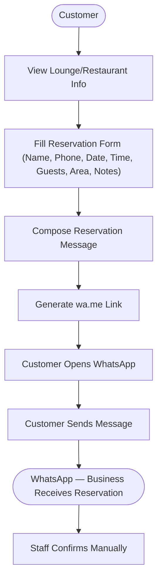
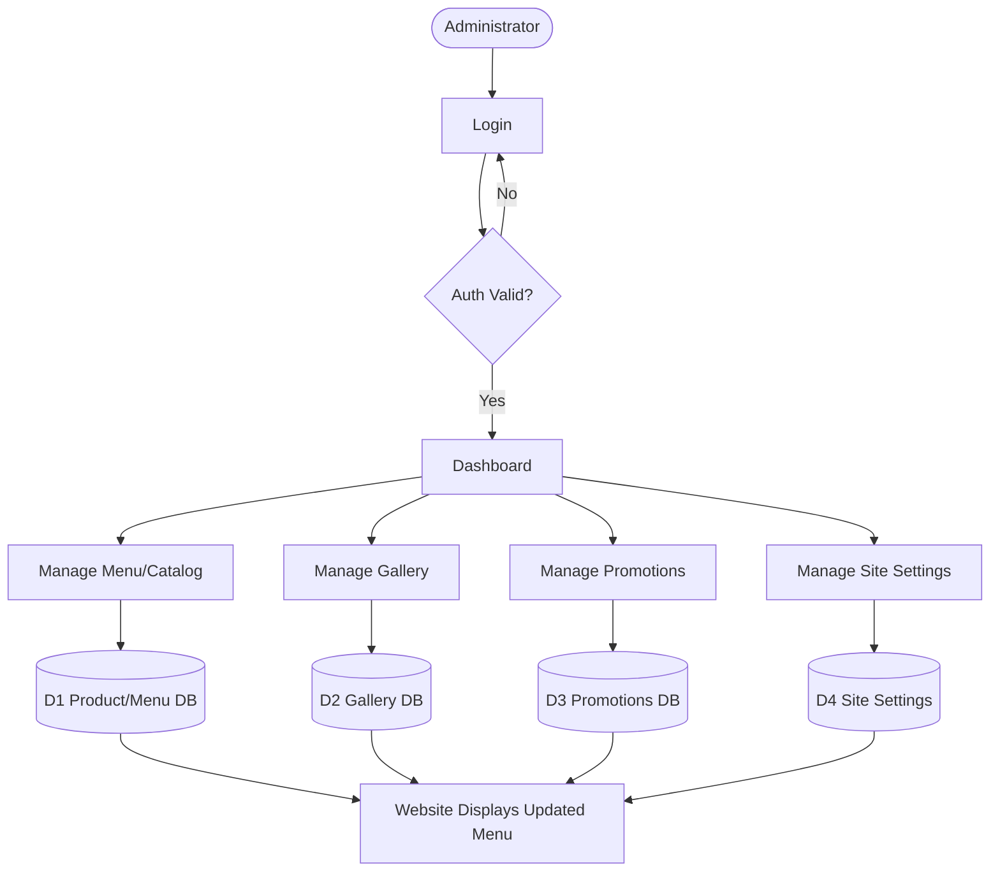

# De Big Tank — Data Flow Diagrams (DFD)

**Document 3 of 6 — Documentation Set**
Status: Draft v0.1
Related: [01-project-overview.md](01-project-overview.md) · [02-software-requirements-specification.md](02-software-requirements-specification.md)

---

## 1. Purpose

These diagrams show how information moves through the De Big Tank system. Because the system deliberately hands off order/reservation completion to WhatsApp (see SRS §3.2–3.3), the flows stay simple: the website prepares and formats data, WhatsApp carries the human conversation, and the admin side manages content.

Diagrams are given in Mermaid syntax (renders in most modern Markdown viewers, GitHub, and diagram tools) with a plain-language walkthrough alongside each one.

## 2. External Entities, Processes, and Data Stores

**External Entities**
- Customer
- Administrator
- WhatsApp (external communication platform — not part of this system)

**Processes**
- P1 Browse Products/Catalog
- P2 Manage Shopping Cart
- P3 Generate WhatsApp Order Message
- P4 Fill & Generate Reservation Message
- P5 Admin Authentication
- P6 Manage Menu/Catalog
- P7 Manage Gallery
- P8 Manage Promotions
- P9 Manage Site Settings/Content

**Data Stores**
- D1 Product/Menu Database (Restaurant, Bakery, Lounge items + categories)
- D2 Gallery Database
- D3 Promotions Database
- D4 Site Settings (business hours, contact info, WhatsApp number, banners, social links)
- D5 Admin Accounts (staff logins only)

Note: there is intentionally **no** Order or Reservation data store in v1 — nothing is persisted server-side once the WhatsApp message is generated (see NFR-12 in the SRS).

## 3. Context Diagram (Level 0)

High-level view: the whole website treated as a single process.

*Walkthrough:* Customers interact only with the website and, at the final step, WhatsApp. Administrators interact only with the website's admin side. WhatsApp is external — the system generates a message and hands it off; it does not manage what happens inside WhatsApp afterward.

## 4. Level 1 DFD — Overall Website Processes

*Walkthrough:* Browsing reads from the Product/Menu DB. Both the order-generation and reservation-generation processes read Site Settings (e.g., the WhatsApp number to route to) but do not write anything back — no order/reservation record is created.

## 5. Order Processing DFD

*Walkthrough:* The website's responsibility ends at step G/H — generating the link and opening WhatsApp. Steps I onward happen entirely inside WhatsApp, outside this system, matching FR-ORDER-7.

## 6. Reservation DFD

*Walkthrough:* Mirrors the order flow exactly, per FR-RES-1–4. No capacity checking or double-booking prevention happens in-system (FR-RES-4) — that judgment call stays with staff.

## 7. Administration / Content Management DFD

*Walkthrough:* Straightforward CRUD-style content management. No order/reservation management screens exist here, consistent with FR-ADMIN-7.

## 8. Data Dictionary

Defines the key data items flowing between processes (not database schemas — those belong in the Software Design Document, Doc 4).

| Data Item | Description | Carried by |
|---|---|---|
| `CustomerInfo` | Name, phone, optional email — entered fresh each time, never stored as an account | Order & Reservation flows |
| `CartItems` | List of `{menuItemId, name, quantity, variant, note}` held client-side for the session | Cart / Order flow |
| `OrderMessage` | Composed human-readable text: customer info, order type, itemized cart, notes, preferred time | Order flow → WhatsApp |
| `ReservationRequest` | Name, phone, email (optional), date, time, guests, area/type, special request | Reservation flow → WhatsApp |
| `Product` | Menu item: id, name, description, price, category, service line, image, availability, variants | Menu DB ↔ Browse/Admin |
| `Category` | Grouping for products within a service line | Menu DB ↔ Browse/Admin |
| `Promotion` | Title, description, image, validity dates | Promotions DB ↔ Admin/Website |
| `GalleryImage` | Image + optional caption | Gallery DB ↔ Admin/Website |
| `SiteSettings` | WhatsApp number, phone, email, address, hours, social links, banners | Settings DB ↔ Admin/Website |

## 9. Why This DFD Fits the Project

The diagrams intentionally show a clean line: the website owns *presentation and message preparation*; WhatsApp owns *the conversation*; staff own *confirmation and fulfillment*. Nothing about orders or reservations is tracked or stored inside the system once handed off — that boundary is drawn deliberately, per the revised scope in Doc 1 and Doc 2, and keeps the system simple to build and maintain.

---

*Next in sequence: Document 4 — Software Design Document (system architecture, ERD/data model for the content-management side, tech stack decisions).*
