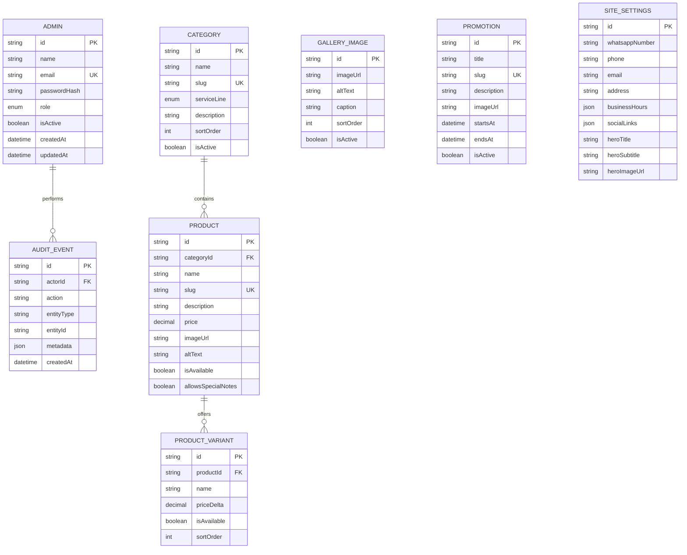

# De Big Tank — Software Design Document

Status: Approved draft v0.2, reconciled with the implementation on 2026-07-31.

## Architecture

The repository is an npm-workspace monorepo:

- `apps/web`: Next.js 16.2, React 19.2, TypeScript and Tailwind CSS.
- `apps/api`: NestJS 11 REST API.
- PostgreSQL is accessed only through Prisma.
- Public ordering and reservations are composed in the browser and handed to `wa.me`. No customer, cart, order, reservation or payment data is sent to the API.
- Staff authenticate against the API with a short-lived JWT. Protected mutations are attributed to the acting administrator.
- Product and gallery images are URL-backed until Cloudinary credentials are supplied.

## Data model

Money is stored as PostgreSQL `Decimal(12,2)` in Naira. A product has one category, and the category determines its Restaurant, Bakery or Lounge service line. Variants apply a relative `priceDelta`.

`SiteSettings` is a singleton with the id `default`. Business hours and social links remain JSON because their business-owned shapes can evolve without unnecessary relational tables.

Category deletion is blocked while products reference it. Product deletion cascades to variants. Routine sold-out handling uses `isAvailable`, not deletion.

## Security

- Passwords are hashed with bcrypt at cost 12.
- There is no public registration endpoint.
- A production-strength `JWT_SECRET` is mandatory at API startup.
- Login is rate-limited to five attempts per minute.
- The JWT guard rechecks that the administrator exists, is active and has the `ADMIN` role.
- API request bodies are whitelisted; unknown fields are rejected.
- All admin content mutations create an `AuditEvent`.
- Bearer tokens are held in staff browser session storage. Because authentication is not cookie-based, cross-site form requests cannot carry staff credentials automatically.
- Customer details remain in browser form state and the generated WhatsApp URL only.

## Deployment

The frontend and API deploy independently. Required production inputs are documented in the environment examples. PostgreSQL backups, HTTPS and runtime logging are deployment-provider responsibilities and must be enabled before launch.
